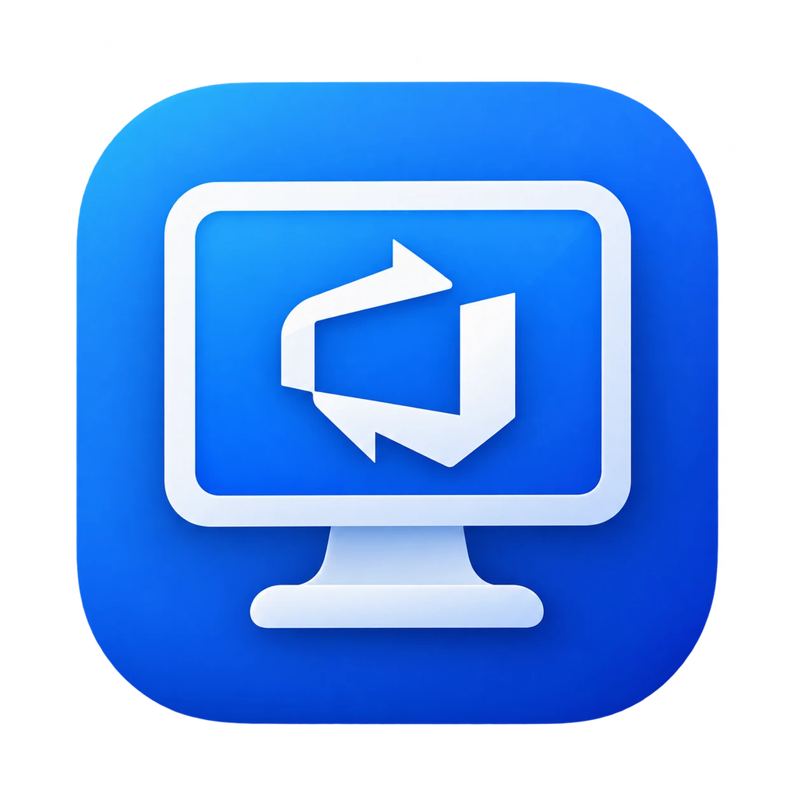

# ADO Desk



A native macOS app for the Azure DevOps work you do every day: the current sprint, your work items, and the reports
you export at the end of it. ADO Desk is a SwiftUI front end for `ado_cli.py`, a small standard-library Python CLI that
talks to the Azure DevOps REST API. You can use either one on its own.

<!-- Screenshot: the Current Sprint view. Save it as docs/images/current-sprint.png and uncomment:

-->

- [Features](#features)
- [Requirements](#requirements)
- [Install](#install)
- [Set up](#set-up)
- [Use the engine from the terminal](#use-the-engine-from-the-terminal)
- [Contributing](#contributing)

## Features

| Section | What it does |
| --- | --- |
| **Current Sprint** | The team's current iteration: dates and days left, an editable sprint goal, closed and active story counts, and the closed stories with **Copy as Markdown**. |
| **Work Items** | The items you've opened, created or updated (type an ID to open another) beside an inline editor. Changed fields are highlighted until you **Save** (⌘S) or **Discard**. Post comments, open an item in the browser, or delete it. |
| **Sprints** | Every iteration, grouped Current / Upcoming / Past, each shown like the home view. |
| **Reports** | Export closed stories or a user's modifications for a date range, and reveal recent exports in Finder. |

Also:

- **New Work Item** (⌘N) suggests the current sprint for the item's area path. **Create another** keeps the sheet
  open with placement and assignment filled in.
- **Command palette** (⌘K): open an item by ID or title, create one, or jump to a section.
- **Activity drawer** (⇧⌘Y) lists every engine call with its command line, duration and raw JSON, for when something
  goes wrong.
- ⌘1–⌘4 switch sections.
- **Updates itself** from GitHub releases, and asks first.

## Requirements

- macOS 13 Ventura or later
- `python3` 3.9 or later. The one from the Xcode Command Line Tools (`xcode-select --install`), Homebrew or python.org
  all work. The engine needs no packages.
- An Azure DevOps [personal access token](https://learn.microsoft.com/azure/devops/organizations/accounts/use-personal-access-tokens-to-authenticate)
  for your organization.

## Install

Run this in Terminal:

```sh
curl -fsSL https://raw.githubusercontent.com/jsonify/ado-desk/main/macos/Scripts/install.sh | bash
```

It downloads the latest release, checks it against the release's checksums, installs it in **Applications** and opens
it. Run it again to update, or use **ADO Desk → Check for Updates…**. ADO Desk also checks a minute after it opens and then once a day, and asks before
installing; turn that off in **Settings → Updates**.

Releases are signed with ADO Desk's own certificate, not an Apple Developer ID. macOS calls a copy downloaded in a
browser "damaged". If you downloaded the DMG or zip from [Releases](https://github.com/jsonify/ado-desk/releases)
instead, drag ADO Desk into **Applications** and run this once before opening it:

```sh
xattr -dr com.apple.quarantine "/Applications/ADO Desk.app"
```

To build it yourself, see [CONTRIBUTING.md](CONTRIBUTING.md).

## Set up

The first launch shows a setup card. Enter your organization, project, team and token, or point ADO Desk at a `.env`
file you already use with the CLI. Everything can be changed later in **Settings** (⌘,):

| Pane | Settings |
| --- | --- |
| **Connection** | Organization, project, team and token. The token is kept in the macOS Keychain. |
| **Defaults** | Assignee, area path and iteration path for new work items and exports. |
| **Engine** | The Python interpreter, the script location, an optional `.env` file and an optional CA bundle. **Verify Engine** checks that the script can be found and launched. |
| **Updates** | The running version, automatic update checks, and **Check Now**. |

A blank field falls back to the engine's `.env` file and environment variables, so a working CLI setup works in the
app as-is.

## Use the engine from the terminal

`ado_cli.py` is a single file with no dependencies. It reads its settings from the environment or a `.env` file in
the current directory:

```sh
# .env: never commit it (it is in .gitignore). Comments go on their own lines.
# ADO_ORG is a bare name or a URL such as https://dev.azure.com/acme.
ADO_ORG=acme
ADO_PROJECT=Platform
ADO_TOKEN=<personal access token>
# The team for the iteration commands.
ADO_TEAM=Platform Team
# Optional defaults for export-closed-stories and create.
ADO_ASSIGNEE=Jane Doe
ADO_AREA_PATH=Platform\Web
```

Exported environment variables win over `.env` values, and `ADO_ENV_FILE=/path/to/.env` points at a file elsewhere.

Then:

```sh
python3 ado_cli.py get --id=1234
python3 ado_cli.py create --title="Add login audit log" --ac="Logins are recorded" --ac="Admins can view them"
python3 ado_cli.py update --id=1234 --state=Active --story-points=3
python3 ado_cli.py comment --id=1234 --body="Deployed to staging"
python3 ado_cli.py iteration-list --timeframe=current
python3 ado_cli.py export-closed-stories --from-date=2026-01-01 --output="$PWD/closed.json"
python3 ado_cli.py --help     # every command; add a command name for its flags
```

Every command prints one JSON object, `{"success": true, "result": …}` or `{"success": false, "error": {"code", "message"}}`,
and exits 0 or 1 (2, with only a usage message, when the arguments are wrong), so it is easy to script with `jq`. Pass values as `--flag=value`: a value starting with `-` (a
Markdown bullet, for example) is otherwise read as an option.

[docs/ENGINE_REFERENCE.md](docs/ENGINE_REFERENCE.md) lists every command's flags, result shape and error codes.

## Contributing

[CONTRIBUTING.md](CONTRIBUTING.md) covers building the app, tests, commit messages, and how releases are made.
[CHANGELOG.md](CHANGELOG.md) lists what changed in each release.
